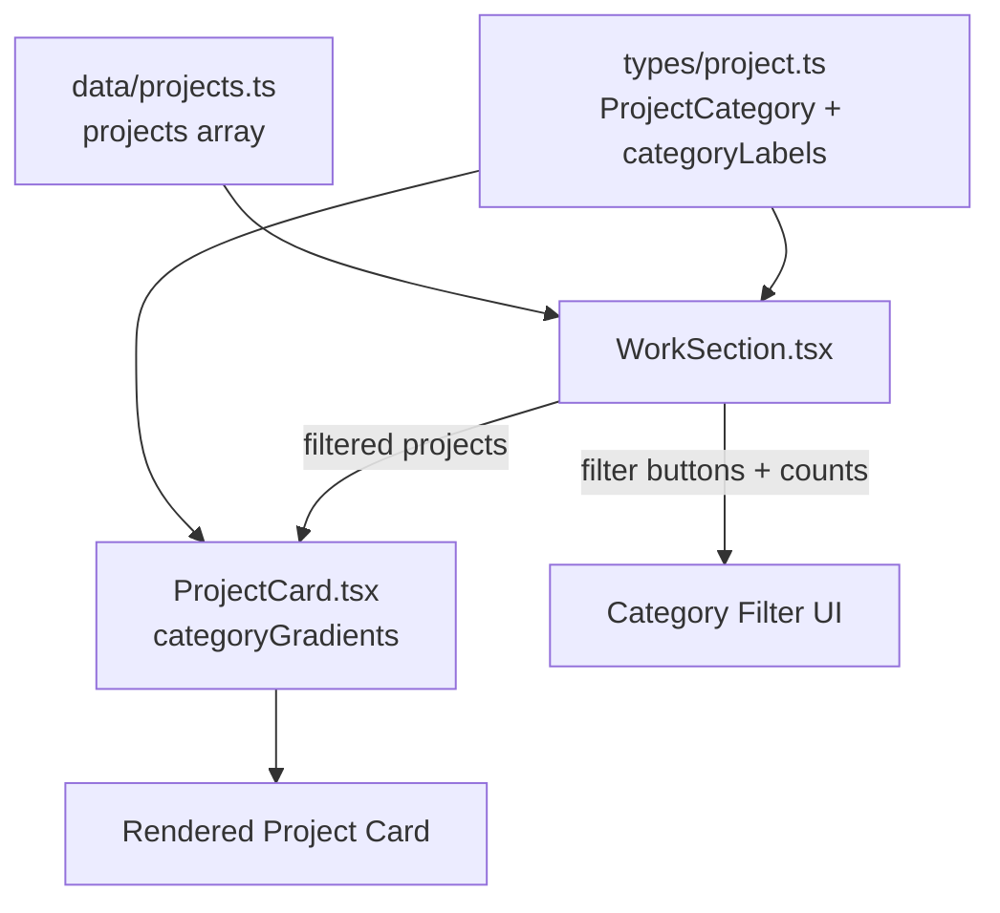

# Design Document: Portfolio Achievement — AI Bidding

## Overview

This design adds a new achievement to the portfolio: an AI-powered automated bidding system for freelancer.com. The portfolio is fully data-driven: projects are declared as typed objects in `data/projects.ts`, classified by a `ProjectCategory` union in `types/project.ts`, and rendered by `WorkSection.tsx` through `ProjectCard.tsx`.

The achievement is AI automation work, which the current categories (enterprise, dashboard, event-platform, creative, consumer) don't describe well. The cleanest approach is to:

1. Add a new `ai-automation` value to the `ProjectCategory` union.
2. Add matching entries to `categoryLabels` (in `types/project.ts`) and `categoryGradients` (in `ProjectCard.tsx`).
3. Add the new project entry to `data/projects.ts`.

No new components are required. The existing render and filter pipeline already supports any project/category once the data and type are in place. This keeps the change minimal and consistent with the project's established pattern ("add a new entry in `data/projects.ts`"), which the Work Section's own empty-state message documents.

## Architecture

The data flows one direction: data → types (classification) → rendering.



Key architectural facts derived from the current code:

- `WorkSection` builds its filter list dynamically: a filter button only appears if `filter === "all"` or at least one project has that category. So adding a project with a new category automatically surfaces its filter button.
- `WorkSection` splits projects into `featured` and `regular` groups. A non-featured project renders in the two-column grid.
- `ProjectCard` looks up `categoryGradients[project.category]`. If a new category is added to the type but not to this record, the gradient lookup returns `undefined` and the gradient preview breaks. This is the main integration risk and is covered by the correctness properties below.
- `categoryLabels` is typed as `Record<ProjectFilter, string>`, so TypeScript enforces a label for every category at compile time. `categoryGradients` is typed as `Record<ProjectCategory, ...>`, so TypeScript enforces a gradient for every category too.

## Components and Interfaces

### Types (`types/project.ts`)

- `ProjectCategory`: extend the union with `"ai-automation"`.
- `categoryLabels`: add `"ai-automation": "AI / Automation"`.
- No change to the `Project` type shape is needed; all required fields already exist.

### Data (`data/projects.ts`)

- Append one new `Project` object for the AI bidding achievement.
- `number`: `"07"` (next unique sequential value).
- `category`: `"ai-automation"`.
- `featured`: omitted (renders in the regular grid) unless the owner wants it highlighted.
- `image`/`href`: optional; omitted by default so the gradient preview renders. If a screenshot is later added to `public/images/`, set `image`.

### Rendering (`ProjectCard.tsx`)

- `categoryGradients`: add an `"ai-automation"` entry with `from`/`to`/`glow` Tailwind classes (e.g. a violet/fuchsia palette distinct from existing categories).
- No logic changes; the component already renders any valid project.

### Filtering (`WorkSection.tsx`)

- `filterOptions`: add `"ai-automation"` to the array so the filter order is explicit. (Even without this, the button would appear because the filter derivation checks project categories; adding it keeps ordering intentional.)

## Data Models

The new project entry conforms to the existing `Project` type:

```typescript
{
  number: "07",
  title: "AI Automated Bidding for Freelancer.com",
  type: "AI Automation Tool",
  category: "ai-automation",
  company: "Independent Project",
  role: "Builder / Developer",
  description:
    "An AI-driven automation that monitors freelancer.com projects and generates tailored, context-aware bid proposals automatically — reducing manual effort and improving response speed on relevant jobs.",
  highlights: [
    "Automated project monitoring and bid submission workflow",
    "AI-generated, context-aware proposals tailored per project",
    "Faster response time on newly posted relevant jobs",
    "Configurable filtering to target the right opportunities"
  ],
  stack: ["AI / LLM", "Automation", "Node.js", "APIs", "Prompt Engineering"],
  impact: "Hands-off bidding that saves time and improves proposal relevance"
}
```

Updated classification model:

```typescript
export type ProjectCategory =
  | "enterprise"
  | "dashboard"
  | "event-platform"
  | "creative"
  | "consumer"
  | "ai-automation"; // new

export const categoryLabels: Record<ProjectFilter, string> = {
  all: "All work",
  enterprise: "Enterprise",
  dashboard: "Dashboard",
  "event-platform": "Event platform",
  creative: "Creative",
  consumer: "Consumer",
  "ai-automation": "AI / Automation" // new
};
```

## Correctness Properties

A property is a characteristic or behavior that should hold true across all valid executions of a system — essentially, a formal statement about what the system should do. Properties serve as the bridge between human-readable specifications and machine-verifiable correctness guarantees. Each property below is universally quantified ("for all") and is intended to be validated with property-based tests.

The prework analysis identified several overlapping acceptance criteria that collapse into a smaller set of comprehensive properties. Field-validity criteria (1.2, 1.4, 1.5, 2.1) combine into a single data-integrity property; the category-map criteria (2.3, 2.4, 2.5, 2.6) combine into one completeness property; and the filter criteria combine into set-membership and button/count properties.

### Property 1: Project data integrity

*For all* projects in the `projects` array, the project SHALL have non-empty `number`, `title`, `type`, `company`, `role`, `description`, and `impact` strings, a `highlights` array with at least three entries, a non-empty `stack` array, and a `category` that is a member of the `ProjectCategory` union.

**Validates: Requirements 1.2, 1.4, 1.5, 2.1**

### Property 2: Project number uniqueness

*For all* pairs of distinct projects in the `projects` array, their `number` values SHALL differ (every project number is unique across the collection).

**Validates: Requirements 1.6**

### Property 3: Category maps completeness and consistency

*For all* `ProjectCategory` values, there SHALL exist exactly one entry in `categoryGradients`, and *for all* `ProjectFilter` values there SHALL exist exactly one entry in `categoryLabels`; conversely, the maps SHALL contain no keys outside their respective value sets.

**Validates: Requirements 2.3, 2.4, 2.5, 2.6**

### Property 4: Card renders all project fields

*For all* projects, rendering the `ProjectCard` SHALL produce output containing the project's `title`, `type`, `role`, `company`, `description`, each displayed `highlight`, each `stack` entry, and the `impact` text.

**Validates: Requirements 3.2**

### Property 5: Conditional preview and link rendering

*For all* projects, when the project has no `image` the rendered `ProjectCard` SHALL show the category gradient preview (no ``), and when the project defines an `href` the rendered card SHALL contain a link whose destination equals that `href`.

**Validates: Requirements 3.3, 3.4**

### Property 6: Category filter restricts to matching projects

*For all* categories and all project datasets, when that category filter is active the `WorkSection` SHALL display only projects whose `category` equals the selected category; and when the selected category contains no projects the empty-state message SHALL be shown (empty-category edge case).

**Validates: Requirements 3.1, 4.2, 4.4**

### Property 7: Filter buttons and counts reflect the data

*For all* categories, the `WorkSection` SHALL render a filter button for a category if and only if at least one project has that category (plus the always-present "all" button), and each rendered button's displayed count SHALL equal the number of projects in that category.

**Validates: Requirements 4.1, 4.3**

## Error Handling

- **Missing category gradient**: If a `ProjectCategory` value exists without a matching `categoryGradients` entry, the lookup returns `undefined` and the gradient preview crashes. The `Record<ProjectCategory, ...>` typing prevents this at compile time; Property 3 verifies it at runtime. The new `ai-automation` entry must be added to both maps in the same change.
- **Duplicate keys**: `ProjectCard` and `WorkSection` use `project.title` and `project.number` as React keys. Property 2 guards number uniqueness; the new entry must also use a title distinct from existing projects.
- **Missing optional assets**: `image` and `href` are optional. The card already branches safely: no `image` → gradient preview; `href` absent → internal `#contact` fallback with no external link. No additional handling needed.
- **Empty filter result**: `WorkSection` already renders a dashed empty-state card when `filteredProjects.length === 0`, so no new handling is required.

## Testing Strategy

The project is TypeScript + Next.js. Tests will use **Vitest** as the runner with **fast-check** for property-based testing and **@testing-library/react** for rendering components. If no test setup exists, it will be added as part of implementation.

**Dual approach:**

- **Property tests** (fast-check, minimum 100 iterations each) validate the universal properties above by generating random valid `Project` objects and random category datasets. Each property test is tagged with a comment: `Feature: portfolio-achievement-ai-bidding, Property {number}: {property_text}`.
- **Unit tests** validate specific examples and edge cases:
  - The AI bidding entry exists in `projects` and its `title` references automated bidding, freelancer.com, and AI (covers Requirements 1.1, 1.3).
  - The `ai-automation` category has both a label and a gradient (concrete instance of Property 3).
  - Empty-category filter shows the empty-state message (edge case within Property 6).

**Configuration notes:**

- Each correctness property is implemented by exactly one property-based test.
- Property generators produce valid `Project` objects (non-empty required fields, valid category) and arrays of them to exercise filtering, counts, and uniqueness.
- Run tests with `vitest --run` for single-execution (non-watch) runs.
